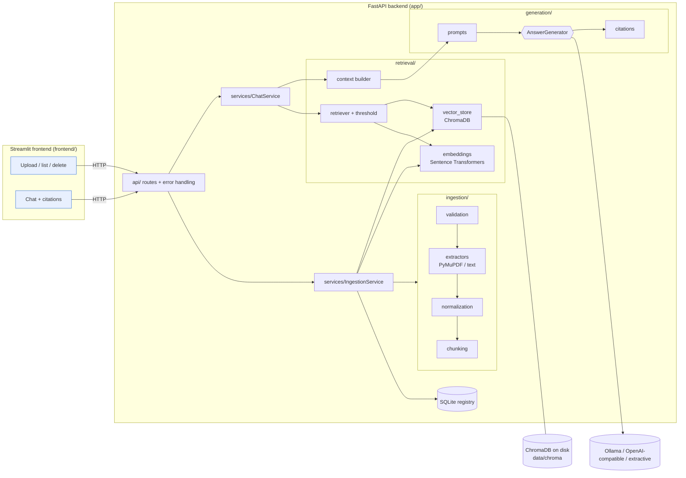

# RAG Knowledge Assistant

Upload PDF and TXT documents, ask questions in plain language, and get answers that are
grounded in the documents — with the filename, page number and a supporting excerpt for
every source. When the documents don't contain the answer, the assistant says so instead
of guessing.

Built with FastAPI, Streamlit, ChromaDB, Sentence Transformers and a pluggable LLM layer
(local Ollama by default, any OpenAI-compatible API, or a no-LLM extractive mode).

> **Status:** a well-tested demo / learning project, not a hardened production service.
> It has no authentication or multi-user isolation. See [Security](#security-and-privacy).

---

## Contents

- [Problem and use cases](#problem-and-use-cases)
- [Architecture](#architecture)
- [How the RAG pipeline works](#how-the-rag-pipeline-works)
- [Technology choices and trade-offs](#technology-choices-and-trade-offs)
- [Project structure](#project-structure)
- [Installation (Linux)](#installation-linux)
- [Running with Docker](#running-with-docker)
- [Configuration reference](#configuration-reference)
- [API reference](#api-reference)
- [Sample questions and outputs](#sample-questions-and-outputs)
- [Evaluation](#evaluation)
- [Testing and quality checks](#testing-and-quality-checks)
- [Document lifecycle](#document-lifecycle)
- [Security and privacy](#security-and-privacy)
- [Known limitations](#known-limitations)
- [Future improvements](#future-improvements)

---

## Problem and use cases

Large language models answer fluently but can invent facts, and they know nothing about
your private documents. Retrieval-Augmented Generation (RAG) fixes part of this: before
answering, the system *retrieves* the most relevant passages from your documents and asks
the model to answer **only** from them, citing which passage supports each statement.

Typical uses:

- Asking questions about manuals, policies or handbooks ("How often do I replace filter X?")
- Pulling numbers and dates out of reports ("What did the project spend in Q3?")
- Checking whether a document covers a topic at all (the assistant refuses when it doesn't)

## Architecture



The frontend contains no business logic: it only calls the API. Each backend package has
one job, and they talk through small interfaces (`Embedder`, `ChromaVectorStore`,
`AnswerGenerator`), so a component can be swapped without touching the others. All objects
are wired once at startup in `app/services/container.py`.

## How the RAG pipeline works

**Indexing (upload)**

1. **Validate** — extension (`.pdf`/`.txt`), size limit, PDF magic bytes, binary check.
   The user's filename is sanitised for display only and never used as a path.
2. **Deduplicate** — SHA-256 of the bytes. The same content uploaded again (even under a
   new name) returns `409 Conflict` with the existing document ID.
3. **Extract** — PyMuPDF reads text page by page (page numbers are kept); TXT is decoded
   as UTF-8 / UTF-16 (with BOM), and mostly-undecodable files are rejected.
4. **Normalise** — Unicode NFKC, rejoin hyphenated and soft-wrapped lines, collapse spaces.
5. **Chunk** — ~1000-character chunks with 150-character overlap, cut at paragraph or
   sentence boundaries where possible. Chunks never span two pages, so each has exactly
   one page number.
6. **Embed + store** — each chunk is embedded and written to ChromaDB with metadata
   (document ID, filename, page, chunk ID/index, upload time). A registry row is added in
   SQLite. If any step fails, the vectors are rolled back.

**Answering (chat)**

1. Validate the question (3–2000 characters).
2. Embed it with the **same** model used for indexing (enforced — see below).
3. Retrieve the top-k chunks by cosine similarity.
4. Drop chunks below the relevance threshold. If none remain, return the
   "I couldn't find enough information…" message **without calling the LLM**.
5. Build a bounded context (default 6000 characters), labelling chunks `S1`, `S2`, …
6. Ask the LLM to answer only from those sources, cite them as `[S1]`, and reply with a
   sentinel if they're insufficient. Source text is wrapped in delimiters and described
   as *untrusted data* to reduce prompt-injection risk.
7. Post-process: remove any citation label the model invented, and build citations from
   the retrieved chunk metadata — so filenames, pages and excerpts are never generated by
   the model.

> **The relevance threshold is a heuristic, not a guarantee.** It filters out clearly
> unrelated questions, but a chunk above the threshold may not contain the answer, and the
> LLM can still produce unsupported statements. Always check the cited passages.

**Why the embedding model is pinned to the database:** vectors from different models are
not comparable. The collection stores the model ID; starting the app with a different
embedding model against an existing database fails with a clear error instead of silently
returning garbage results.

## Technology choices and trade-offs

| Component | Choice | Why | Trade-off |
|---|---|---|---|
| API | FastAPI + Pydantic | Typed validation, automatic OpenAPI docs | — |
| UI | Streamlit | Fast to build, pure Python | Limited layout control; reruns the script on each interaction |
| PDF | PyMuPDF | Fast, accurate text + page info | No OCR: scanned PDFs are rejected |
| Vectors | ChromaDB (embedded, persistent) | No separate server, metadata filters | Single-process; not meant for millions of chunks or many writers |
| Registry | SQLite (stdlib) | Cheap listing and duplicate checks | Separate store to keep consistent (handled with rollback) |
| Embeddings | `all-MiniLM-L6-v2` | Small (~90 MB), CPU-friendly, good general quality | English-centric; 256-token window; weaker than large models |
| Offline embeddings | `hashing` (built in) | No download, deterministic — used by tests | Lexical only: matches words, not meaning |
| LLM | Ollama (default) | Free, local, private | Needs RAM/CPU (or GPU); small models are less accurate |
| LLM (alt.) | OpenAI-compatible API | Strong models, no local hardware | Costs money; document excerpts leave your machine |
| LLM (alt.) | Extractive | Zero setup, works offline | Quotes sentences; can't combine facts or rephrase |

### Local vs hosted inference

| | Local (Ollama) | Hosted (OpenAI-compatible) |
|---|---|---|
| **Cost** | Free after download | Pay per token |
| **Privacy** | Excerpts stay on your machine | Questions + excerpts sent to the provider |
| **Speed** | `llama3.2:3b` on a modern laptop CPU: roughly several seconds to tens of seconds per answer; much faster on a GPU | Usually a few seconds, depends on network and load |
| **Hardware** | ~4 GB free RAM for a 3B model; 8 GB+ for 7–8B models | None |
| **Quality** | Small models follow citation rules less reliably | Larger models generally answer and cite better |

When a hosted provider is configured, `/health` reports `"llm_is_external": true`, the
server logs a warning at startup and the UI shows a notice.

## Project structure

```
rag-knowledge-assistant/
├── app/
│   ├── main.py                  # FastAPI app factory + lifespan
│   ├── api/                     # routes, dependencies, error handlers, request logging
│   ├── core/                    # settings (env vars), domain exceptions, logging
│   ├── ingestion/               # validation, extraction, normalisation, chunking
│   ├── retrieval/               # embedders, ChromaDB store, retriever, context builder
│   ├── generation/              # prompts, providers (Ollama/OpenAI/extractive), citations
│   ├── services/                # ingestion + chat pipelines, SQLite registry, wiring
│   ├── models/                  # internal dataclasses and API schemas
│   └── evaluation/              # dataset loader, metrics, runner (python -m app.evaluation)
├── frontend/                    # Streamlit UI + thin API client
├── tests/                       # pytest suite (offline, temp dirs)
├── data/
│   ├── samples/                 # fictional sample documents (committed)
│   ├── eval/eval_dataset.json   # evaluation questions + expected evidence
│   ├── uploads/  chroma/        # runtime data (git-ignored)
├── scripts/                     # sample PDF generator, end-to-end smoke test
├── docs/evaluation/             # the evaluation report quoted in this README
├── .streamlit/config.toml       # UI upload limit + theme
├── Dockerfile  docker-compose.yml  .env.example
├── requirements.txt  requirements-dev.txt  pyproject.toml
```

## Installation (Linux)

Requirements: Python 3.11+, ~2 GB disk for dependencies, internet access for the first
install and the first embedding-model download.

```bash
cd rag-knowledge-assistant
python3.11 -m venv .venv
source .venv/bin/activate
pip install --upgrade pip

# CPU-only machines: install the small CPU build of PyTorch first (skips ~2 GB of CUDA)
pip install torch --index-url https://download.pytorch.org/whl/cpu

pip install -r requirements-dev.txt     # runtime + test/lint tools
cp .env.example .env                    # then edit as needed
```

### Choose how answers are generated

**Option A — Ollama (default, free, local)**

```bash
curl -fsSL https://ollama.com/install.sh | sh     # or see https://ollama.com/download
ollama pull llama3.2:3b
# LLM_PROVIDER=ollama is already the default in .env
```

**Option B — hosted, OpenAI-compatible API**

```bash
# in .env
LLM_PROVIDER=openai_compatible
OPENAI_API_KEY=sk-...
OPENAI_MODEL=gpt-4o-mini
# Other compatible services: change OPENAI_BASE_URL (e.g. Groq, OpenRouter, LM Studio)
```

**Option C — no LLM at all**

```bash
LLM_PROVIDER=extractive        # answers quote the best-matching sentences
```

If your machine can't download from Hugging Face, also set `EMBEDDING_PROVIDER=hashing`
(lower retrieval quality; see [Evaluation](#evaluation)).

### Run

```bash
# terminal 1 — API (first start downloads the embedding model, ~90 MB)
uvicorn app.main:app --reload --port 8000

# terminal 2 — UI
streamlit run frontend/streamlit_app.py
```

- UI: http://localhost:8501
- API docs (Swagger): http://localhost:8000/docs
- Health: http://localhost:8000/health

Check everything end to end against the running API:

```bash
python scripts/smoke_test.py            # uploads samples, asks questions, cleans up
```

## Running with Docker

```bash
cp .env.example .env                    # edit provider settings first
docker compose up --build               # UI on :8501, API on :8000
```

- Data (vector DB, registry) lives in the `rag_data` volume; the downloaded embedding
  model in `model_cache`. Both survive rebuilds.
- By default the backend reaches **Ollama on your host** via
  `http://host.docker.internal:11434`. Make sure Ollama listens on an address the container
  can reach (e.g. `OLLAMA_HOST=0.0.0.0 ollama serve`).
- To run Ollama in a container instead:

  ```bash
  # in .env: DOCKER_OLLAMA_BASE_URL=http://ollama:11434
  docker compose --profile ollama up --build -d
  docker compose exec ollama ollama pull llama3.2:3b
  ```

Useful commands:

```bash
docker compose logs -f backend          # follow API logs
docker compose up --build -d            # rebuild after code changes
docker compose down                     # stop (keeps volumes)
docker compose down -v                  # stop AND delete indexed data
```

Credentials are passed at runtime from `.env`; they are never copied into the image
(`.env` is in `.dockerignore`).

## Configuration reference

All settings are environment variables (or lines in `.env`). Empty values mean "not set".

| Variable | Default | Description |
|---|---|---|
| `LOG_LEVEL` | `INFO` | Logging level |
| `DATA_DIR` | `data` | Where the vector DB, registry and optional uploads are stored |
| `CORS_ORIGINS` | `["http://localhost:8501"]` | JSON list of browser origins allowed to call the API |
| `ENABLE_DEBUG_ENDPOINTS` | `false` | Enables `GET /documents/{id}/chunks` (returns raw text) |
| `MAX_UPLOAD_MB` | `20` | Maximum upload size |
| `MAX_PDF_PAGES` | `500` | Maximum pages per PDF |
| `STORE_UPLOADS` | `false` | Keep one copy of each original file in `DATA_DIR/uploads` |
| `CHUNK_SIZE` / `CHUNK_OVERLAP` | `1000` / `150` | Characters per chunk / overlap (overlap < size) |
| `EMBEDDING_PROVIDER` | `sentence_transformers` | `sentence_transformers` or `hashing` |
| `EMBEDDING_MODEL` | `sentence-transformers/all-MiniLM-L6-v2` | Any Sentence Transformers model |
| `EMBEDDING_DEVICE` | `cpu` | `cpu`, `cuda`, `mps` |
| `TOP_K` | `5` | Chunks retrieved per question |
| `MIN_RELEVANCE_SCORE` | *(per embedder)* | Cosine-similarity cut-off; default 0.30 (MiniLM) / 0.12 (hashing) |
| `MAX_CONTEXT_CHARS` | `6000` | Context budget sent to the LLM |
| `LLM_PROVIDER` | `ollama` | `ollama`, `openai_compatible` or `extractive` |
| `LLM_TEMPERATURE` / `LLM_MAX_TOKENS` / `LLM_TIMEOUT_SECONDS` | `0.1` / `600` / `120` | Generation settings |
| `OLLAMA_BASE_URL` / `OLLAMA_MODEL` | `http://localhost:11434` / `llama3.2:3b` | Ollama connection |
| `DOCKER_OLLAMA_BASE_URL` | `http://host.docker.internal:11434` | Ollama URL used by Docker Compose |
| `OPENAI_BASE_URL` / `OPENAI_API_KEY` / `OPENAI_MODEL` | OpenAI / *(none)* / `gpt-4o-mini` | OpenAI-compatible connection |
| `API_URL` | `http://localhost:8000` | Backend URL used by the Streamlit UI |

The `0.30` default for MiniLM is a starting point typical for this model family; it was
**not** tuned on this project's evaluation set (the model couldn't be downloaded in the
build environment — see below). Re-tune it with the evaluation's threshold sweep.

## API reference

Interactive docs at `/docs`. All errors return
`{"error": "<code>", "message": "...", "request_id": "..."}` — never a stack trace.

| Method | Path | Description | Notable statuses |
|---|---|---|---|
| `GET` | `/health` | Status of embeddings, vector store and LLM; `llm_is_external` | 200 (`status`: `ok`/`degraded`) |
| `POST` | `/documents/upload` | Multipart `file` (.pdf/.txt). Returns document metadata + warnings | 201, 409 duplicate, 413 too large, 415 type, 422 invalid/no text |
| `GET` | `/documents` | List indexed documents | 200 |
| `GET` | `/documents/{id}` | One document's metadata | 200, 404 |
| `DELETE` | `/documents/{id}` | Delete document, its vectors and stored file | 200, 404 |
| `GET` | `/documents/{id}/chunks?offset=&limit=` | Debug: inspect chunks (disabled unless `ENABLE_DEBUG_ENDPOINTS=true`) | 200, 404 |
| `POST` | `/chat` | `{"question", "top_k"?, "min_score"?, "document_ids"?}` | 200, 422, 503 provider unavailable |

```bash
curl -F "file=@data/samples/aquapure_w300_manual.pdf" http://localhost:8000/documents/upload
curl -X POST http://localhost:8000/chat -H "Content-Type: application/json" \
     -d '{"question": "How often should the RO membrane be replaced?"}'
```

`/chat` response shape:

```json
{
  "answer": "...",
  "status": "answered | insufficient_evidence",
  "citations": [{"label": "S1", "document_id": "doc_…", "filename": "…", "page_number": 3,
                 "chunk_id": "doc_…-00004", "score": 0.41, "excerpt": "…",
                 "explicitly_cited": true}],
  "retrieved_count": 3, "provider": "ollama", "model": "llama3.2:3b", "latency_ms": 2140
}
```

`explicitly_cited: false` means the model didn't use `[S#]` markers; the retrieved
passages are listed so you can still check the evidence.

## Sample questions and outputs

The `data/samples/` folder has three fictional documents: a 5-page product manual (PDF),
an employee handbook and a project status report (TXT). These outputs are **real**, taken
from the smoke test run in extractive mode with the hashing embedder:

**Q:** *How often should the reverse osmosis membrane be replaced?*

```
- Stage 3 - Reverse osmosis membrane (part AP-RO3): every 24 months. [S1]
Sources: [S1] aquapure_w300_manual.pdf — page 3
```

**Q:** *What is the capital city of Australia?*

```
I couldn't find enough information in the uploaded documents to answer this question.
```

More to try: *"How many weeks of parental leave do non-birth parents receive?"*,
*"How much did Project Helios spend in Q3 2026?"*, *"What does error code E2 mean?"*,
*"How much did Project Helios spend in Q1 2026?"* (not in the documents).

With an LLM provider configured, answers are written in prose with `[S#]` markers instead
of quoted bullet points.

## Evaluation

```bash
python -m app.evaluation                                   # uses your .env settings
python -m app.evaluation --embedding-provider hashing --llm-provider extractive \
       --output reports/eval_hashing_extractive.json
```

The runner indexes the sample documents into a **temporary** directory (your data is never
touched), asks every question through the real pipeline, prints a summary and writes a
JSON report with per-case details.

**Dataset** (`data/eval/eval_dataset.json`): 23 hand-written cases — 18 answerable
(numeric facts, dates, multi-section, and *confusable* questions such as Q2 vs Q3 figures
or two different warranties) and 5 unanswerable (off-topic plus near-misses like
"Q1 spending" or "part-time leave", which the documents don't cover). Each answerable case
lists the expected evidence: file, page (for PDFs) and an exact text snippet.

**Metrics**

- *Retrieval* (answerable cases): **Hit@k** (a relevant chunk in the top k), **evidence
  Recall@k** (share of required evidence snippets found in the top k) and **MRR**.
  A chunk is relevant if it's from the expected file/page and contains the snippet.
- *Abstention*: unanswerable questions correctly refused; answerable ones wrongly refused.
- *Answers* (cases that were answered): expected keywords present, citation hit rate
  (a cited chunk is relevant), citation precision, and a lexical **sentence-support ratio**
  (share of answer sentences whose words mostly appear in the cited chunks).
- A *threshold sweep* shows how other `MIN_RELEVANCE_SCORE` values would trade off.

### Measured results

Run on 2026-10-13, report: [`docs/evaluation/eval_hashing_extractive.json`](docs/evaluation/eval_hashing_extractive.json).

> ⚠️ **Configuration caveat.** The build environment blocked Hugging Face and had no LLM
> available, so these numbers come from the **offline fallback configuration**:
> `hashing` embeddings + `extractive` answers. They are a lower-bound baseline, **not**
> the default MiniLM + Ollama setup. Run `python -m app.evaluation` on your machine to
> measure the default configuration.

| Metric | Value |
|---|---|
| Hit@1 / Hit@3 / Hit@5 | 0.83 / 1.00 / 1.00 |
| Evidence Recall@1 / @3 | 0.81 / 1.00 |
| MRR | 0.92 |
| Unanswerable correctly refused | 0.40 (2 of 5) |
| Answerable wrongly refused | 0.11 (2 of 18) |
| Answers containing expected facts | 0.69 (11 of 16 answered) |
| Citation hit rate / precision | 0.94 / 0.78 |
| Sentence-support ratio | 1.00 *(trivial in extractive mode: answers are copied)* |

**What this tells us:** retrieval is solid even with plain word matching — the right
passage was always in the top 3. The weak points are (1) **abstention**: with a lexical
embedder, near-miss questions ("Q1 spending", "part-time leave") score as high as real
ones, so the threshold can't separate them; and (2) the **extractive** mode can't combine
two facts (both multi-section questions failed) or pick the right number from a sentence
list. Both are exactly what the semantic embedder and an LLM are meant to improve — but
that needs to be measured, not assumed.

### Limitations of this evaluation

- 23 questions over 3 small fictional documents: wide uncertainty, no generalisation claims.
- Relevance and answer checks are string matches; correct paraphrases can fail and wrong
  answers that mention a keyword can pass.
- The support ratio is lexical; it cannot detect contradictions or bad reasoning.
- No LLM-as-a-judge is used. If you add one, treat its scores as opinions, not ground truth.
- LLM outputs vary between runs and model versions.

## Testing and quality checks

```bash
pytest                     # 106 tests, offline, ~5 s
pytest --cov               # with coverage (96% of app/, evaluation excluded)
ruff check . && ruff format --check .
mypy                       # strict mode over app/ and frontend/
```

Tests use temporary directories and isolated databases, the offline hashing embedder,
and mocked HTTP for Ollama/OpenAI (`httpx.MockTransport`), so they need no network,
model download or API key. They cover extraction (PDF/TXT/encodings/corrupt/scanned),
chunking and IDs, vector retrieval and filters, duplicates, deletion and rollback,
relevant/irrelevant queries, citation metadata and invented-label removal,
insufficient-evidence paths, every API endpoint and error code, provider failures and
missing configuration, secret masking, prompt-injection delimiter escaping and the
evaluation harness.

## Document lifecycle

1. **Upload** — bytes are held in memory (rejected early if over the size limit).
2. **Processing** — text is extracted and chunked in memory. By default the original file
   is **not written to disk** (`STORE_UPLOADS=false`): only what's needed for search is
   kept, so there's no duplicate copy of your document.
3. **Stored data** — chunk text + vectors + metadata in `DATA_DIR/chroma`; one row per
   document in `DATA_DIR/registry.sqlite3`. With `STORE_UPLOADS=true`, one copy of the
   original at `DATA_DIR/uploads/<document_id>.<ext>` (internal name, never the user's).
4. **Delete** — `DELETE /documents/{id}` removes the vectors, the registry row and the
   stored file (if any). Note: ChromaDB may keep freed space in its files until compaction;
   for guaranteed erasure, delete `DATA_DIR` (or `docker compose down -v`).

Document IDs are derived from the content hash (`doc_` + 16 hex chars), and chunk IDs are
`<document_id>-<index>`, so re-indexing the same file produces the same IDs.

## Security and privacy

What's implemented:

- Upload limits (size, pages, extension, PDF signature, binary detection).
- Internal filenames only — user filenames are sanitised and never used as paths
  (path traversal like `../../etc/passwd.txt` is neutralised); document IDs in URLs are
  validated against a strict pattern.
- Secrets only from environment variables; `SecretStr` masks them in logs/reprs; errors
  never include them; `.env` excluded from Git and Docker images.
- Logs contain method, path, status, timing, IDs and counts — never document text,
  questions or answers.
- Clients get structured error messages, never stack traces (request IDs link to logs).
- Prompt-injection mitigation: sources are delimited, labelled as untrusted data, and
  delimiter-like text inside documents is neutralised. The UI renders excerpts as plain
  text. **This reduces, but cannot eliminate, injection risk.**
- Debug chunk endpoint off by default; containers run as a non-root user.

**Dependency audit (pip-audit, 2026-10-13):** only `chromadb 1.5.9` has known advisories
(PYSEC-2026-311, -3813, -3814, -3815), with no fixed version released yet. All four concern
ChromaDB's **HTTP server** (`/api/v2/...` endpoints and its RBAC provider). This project
uses ChromaDB only as an embedded library (`PersistentClient`) and never starts or exposes
a Chroma server, so those endpoints aren't reachable here. Re-run `pip-audit -r
requirements.txt` and upgrade when a fix ships; never expose a standalone Chroma server.

What's **not** implemented — required before any public or multi-user deployment:
authentication and authorisation, per-user document isolation, rate limits and quotas,
TLS termination, malware scanning of uploads, audit logging, and encryption at rest.
Run it on localhost or a trusted network only.

## Known limitations

- **No OCR**: scanned/image-only PDFs are rejected; image-only pages are skipped with a
  warning.
- Tables, multi-column layouts and headers/footers are extracted as plain text, which can
  scramble table rows.
- Character-based chunking may split a table or list; chunks never cross pages, so an
  idea spanning a page break is split.
- `all-MiniLM-L6-v2` is English-focused and truncates inputs beyond ~256 tokens.
- Single-turn chat: follow-up questions don't use earlier conversation turns.
- ChromaDB embedded mode is single-process; run one API worker.
- Small local models may ignore the citation format or the "insufficient evidence" rule;
  the app handles this (lists sources as "not cited explicitly"), but answers can still
  be wrong.

## Future improvements

- Hybrid search (BM25 + vectors) and a cross-encoder re-ranker for better precision.
- OCR for scanned PDFs (e.g. Tesseract via PyMuPDF), DOCX/HTML support, table-aware parsing.
- Conversation memory with query rewriting for follow-up questions.
- Streaming answers; background ingestion jobs with progress for large files.
- Authentication, per-user collections, quotas.
- Evaluate the default MiniLM + Ollama configuration and a larger dataset; tune the
  threshold per model; add human review of answers.

## License

MIT — sample documents are fictional and contain no personal data.
